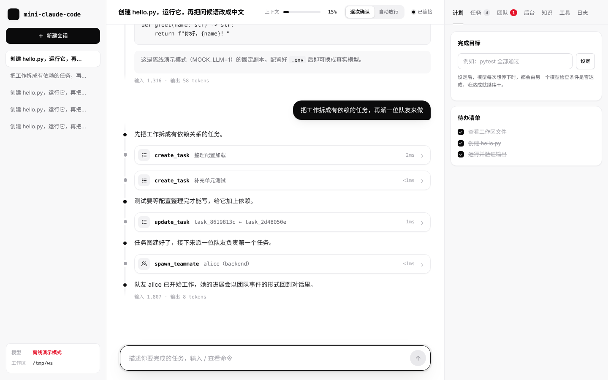

# mini-claude-code

一个从零搭起来的编程智能体 Harness：模型负责决策，这里负责给它工具、权限边界、上下文和记忆。



## 快速开始

需要 Python 3.10+。

```bash
cd backend
pip install -r requirements.txt
copy .env.example .env        # 填入 ANTHROPIC_API_KEY / ANTHROPIC_BASE_URL / MODEL_ID
```

然后双击项目根目录的 `start.bat`，或者手动开两个终端：

```bash
cd backend  && python main.py      # 后端  http://127.0.0.1:8000
cd frontend && python serve.py     # 前端  http://127.0.0.1:5173
```

没有 API Key 也能先看效果：设置环境变量 `MOCK_LLM=1` 再启动后端（没有 `.env` 时 `start.bat` 会自动这样做），
后端会用一个按固定剧本回复的假模型跑通整条链路。

Agent 默认在项目根目录下的 `workspace/` 里干活，用 `.env` 里的 `AGENT_WORKDIR` 可以指向别的目录。
任务绑定 worktree 的功能要求工作目录是一个 Git 仓库。

## 目录结构

```
mini-claude-code/
├── backend/
│   ├── main.py                    启动入口
│   ├── app/
│   │   ├── api/                   接口层：只做参数校验和 HTTP 转换
│   │   │   ├── server.py          FastAPI 应用装配（CORS、路由、生命周期）
│   │   │   ├── routes.py          REST 路由
│   │   │   ├── sse.py             事件流（Server-Sent Events）
│   │   │   └── schemas.py         请求体模型
│   │   ├── service/
│   │   │   └── agent_service.py   主链路门面：只对外暴露方法
│   │   └── core/                  Harness 核心，一个文件一项机制（见下表）
│   └── skills/                    技能目录：<名称>/SKILL.md
├── frontend/                      纯静态前端（原生 ES Module，无需构建）
│   ├── index.html
│   ├── css/                       tokens / layout / chat / inspector
│   └── js/
│       ├── api.js                 所有请求的唯一出口
│       ├── main.js                入口：把接口、事件流和视图接在一起
│       └── views/                 chat / toolcard / inspector / sidebar
└── start.bat
```

调用方向只有一个：`api → service → core`。接口层不直接碰 core 的内部状态，core 也不知道 HTTP 的存在。

## 机制与文件的对应关系

| 课程章节 | 机制 | 文件（`backend/app/core/`） |
|---|---|---|
| s01 | Agent 主循环 | `loop.py` |
| s02 | 工具分发、基础工具 | `tool_registry.py`、`tools_base.py`、`dispatch.py` |
| s03 | 权限治理 | `permission.py` |
| s04 | Hooks | `hooks.py`、`dispatch.py`（内置钩子） |
| s05 | TodoWrite | `todo.py` |
| s06 | 子 Agent | `subagent.py` |
| s07 | Skill 按需加载 | `skills.py` |
| s08 | 上下文压缩 | `compact.py` |
| s09 | 跨会话记忆 | `memory.py` |
| s10 | 任务系统（依赖图） | `tasks.py` |
| s11 | 后台任务 | `background.py` |
| s12 | 定时调度 | `cron.py` |
| s13 | Agent Teams、worktree | `teams.py`、`worktree.py` |
| s14 | MCP 工具接入 | `mcp.py` |
| s15 | 集成：system prompt 组装、错误恢复 | `prompt.py`、`context.py`、`recovery.py` |
| s16 | Workflow Runtime | `workflow.py` |
| s17 | Goal Loop | `goal.py` |

另外三个文件是为 Web 化新增的：`config.py`（配置）、`events.py`（事件总线）、`mock_llm.py`（离线演示用的假模型）。

## 一轮对话是怎么跑的

```
POST /api/sessions/{id}/messages          前端提交消息，立即返回 202
        │
        ▼
AgentService.send_message                 起一个线程执行本轮
        │
        ▼
loop.agent_loop ── 每一步 ──────────────────────────────────────────────┐
  1. 注入定时任务 / 后台任务通知 / todo 提醒                                │
  2. 上下文压缩，组装 system prompt 和工具池                               │
  3. 调用模型（流式）；失败时重试、升级 max_tokens 或被动压缩                 │
  4. 没有 tool_use → Goal 评估 → Stop 钩子 → 提取记忆 → 结束               │
  5. 有 tool_use → PreToolUse 钩子（权限）→ 执行 → PostToolUse 钩子 ───────┘
        │
        ▼ 过程中的每件事都 emit 成事件
GET /api/events (SSE)                     前端据此渲染文字、工具卡片、权限确认
```

## 接口

| 方法 | 路径 | 作用 |
|---|---|---|
| GET | `/api/events` | 事件流（SSE） |
| GET | `/api/state?session_id=` | 右侧面板需要的全部状态 |
| GET | `/api/tools` | 当前工具池 |
| GET / POST | `/api/sessions` | 列出 / 新建会话 |
| DELETE | `/api/sessions/{id}` | 删除会话 |
| GET | `/api/sessions/{id}/events` | 回放会话的历史事件（刷新页面后重建界面） |
| POST | `/api/sessions/{id}/messages` | 发送消息或斜杠命令 |
| POST | `/api/stop` | 中断当前轮次 |
| POST | `/api/permissions/{id}` | 回答一次权限确认 |
| PUT | `/api/settings/permission-mode` | 切换 `ask` / `auto` |
| PUT / DELETE | `/api/goal` | 设定 / 清除完成目标 |
| DELETE | `/api/crons/{id}` | 取消定时任务 |
| POST | `/api/mcp/{name}/connect` | 连接 MCP server |
| GET | `/api/memory/{filename}`、`/api/skills/{name}` | 查看记忆 / 技能全文 |

启动后端后可以在 `http://127.0.0.1:8000/docs` 直接调试这些接口。

输入框支持的命令：`/goal <完成条件>`、`/goal clear`、`/compact`、`/mode ask|auto`。


